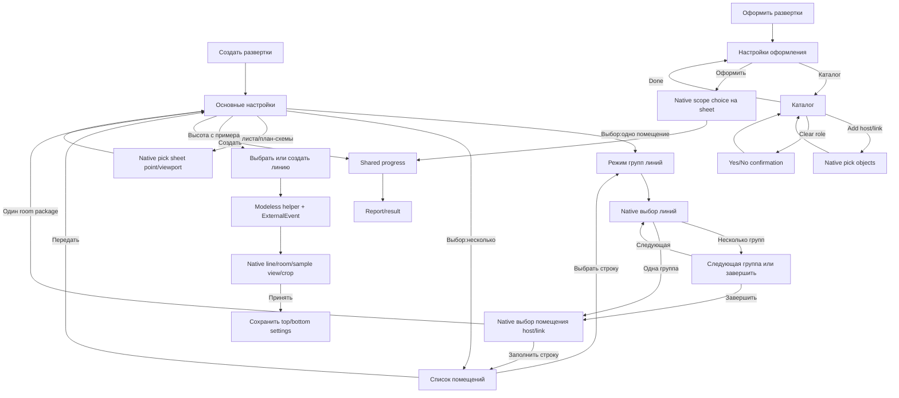

# «Развёртки» — фактический состав и переходы

12.10.2026. Source inventory существующей роли documenter; сборка, WPF, Revit и операции модели здесь не запускались. Новый запрос из `C:/Users/svetl/.codex/attachments/66652fc6-7d2d-4f47-ae89-2be57f37464a/Вставленный текст.txt` разрешает **весь комплект только в изолированном interactive Preview**, затем показ и остановку до явного approval комплекта. Прежнее approval двух других модулей и reviewer ship этого разрешения не заменяют. Production/installer/commit не меняются этим inventory.

Нормы: [Specification](Specification.md), [ErrorRegistry](ErrorRegistry.md), [Workflow](Workflow.md), [ReviewRoles](ReviewRoles.md), [LayoutPatterns](LayoutPatterns.md), [STATUS](STATUS.json). Этот файл описывает функции и источник, не создаёт второй стандарт. Будущий [layout](Elevations-Layout.md) и evidence заполняются builder отдельно.

## Состав и доступность

В `SAB/Cls_InteriorElevations/Views` десять оконных классов/XAML. Все десять включены в Compile/Content [SAB.csproj](../../../SAB/SAB.csproj); **девять имеют действующие call sites, один standalone RoomPlanSchemeSettingsWindow не вызывается**. Это не десять одинаково достижимых окон. Дополнительно два command flow используют общий progress-класс другого модуля; есть native confirmations, result/report и Revit selection surfaces. Скрытых дополнительных `new Window`/file-picker/custom popup в модуле поиском не найдено; C# создаёт также RichTextBox document/Run внутри существующего окна.

Шесть действующих ribbon entry points: [MainPanel.cs](../../../SAB/Cls_MainPanel/MainPanel.cs), блок «Развертки»: «Создать развертки по линии», «Повернуть на180°», «Границы видов», «На следующий лист», «Оформить развертки», «Настройки оформления». Их команды — `CreateInteriorElevationsCommand`, `FlipElevation180ByLineCommand`, `AdjustElevationCropCommand`, `MoveElevationViewportsToNewSheetCommand`, `DecorateInteriorElevationsCommand`, `ConfigureElevationDecorationCatalogCommand`.

| Окно / фактический вход | Обязательные данные, действия и выход | Зависимости / состояния |
|---|---|---|
| **ElevationSettingsWindow** — Create command, цикл `Execute` | `ElevationSettingsViewModel(Document,savedSettings)`, selection-ready flag, selection/status/warnings. Четыре вкладки «Развертки», «Лист», «План-схема», «Марки», naming/preview и room-mode/model-source. Возвращает `SelectedSettings` и `RequestedAction`: PickSelection/Create/PickSheetPoint/PickRoomPlanPoint/PickCropByExample; Cancel=false. | Create disabled до полного переданного выбора. Settings сохраняются после каждого modal return, включая Cancel. Existing sheet/plan и auto/manual modes меняют доступность. [code](../../../SAB/Cls_InteriorElevations/Views/ElevationSettingsWindow.xaml.cs), [VM](../../../SAB/Cls_InteriorElevations/ViewModels/ElevationSettingsViewModel.cs). |
| **MultiRoomSelectionWindow** — `TryEditMultiRoomSelectionList` | Общая `ObservableCollection<MultiRoomSelectionItem>`;7колонок: №, номер/имя помещения, групп линий, выбрано линий, статус, действия. «Выбрать», row plus/delete, «Передать список помещений», Cancel. Выход `RequestedAction`+`RequestedRow`; список сохраняется в command session. | Пустой список получает1blank row; удаление последней тоже оставляет1. Transfer требует все строки completed и уникальные `(LinkInstanceId,RoomElementId)`. Cancel не уничтожает уже заполненные session rows. [window](../../../SAB/Cls_InteriorElevations/Views/MultiRoomSelectionWindow.xaml.cs), [VM](../../../SAB/Cls_InteriorElevations/ViewModels/MultiRoomSelectionViewModel.cs). |
| **LineGroupSelectionWindow** — `TrySelectLineGroupSelectionMode` внутри выбора помещения | «По одной группе линий»/«По нескольким группам линий»/Cancel; output `IsMultipleGroups`, DialogResult. | Компактный modal выбор перед native line picking; отмена прекращает текущую selection branch. [code](../../../SAB/Cls_InteriorElevations/Views/LineGroupSelectionWindow.xaml.cs). |
| **LineGroupNextActionWindow** — `AskGroupSelectionNextAction(groupNumber)` | Номер текущей группы; «Выбрать следующую группу линий», «Завершить выбор групп», Cancel. Output `IsNextGroupAction`. | Только multi-group branch после корректной непустой группы; следующий номер/finish/cancel возвращаются command loop. [code](../../../SAB/Cls_InteriorElevations/Views/LineGroupNextActionWindow.xaml.cs). |
| **CropByExampleActionWindow** — main action PickCropByExample | «Выбрать линию»/«Создать линию»/«Закрыть»; enum PickLine/CreateLine/None. | Close возвращает main settings loop. Успешный выбор начинает отдельный modeless workflow; main command заканчивается Succeeded. [code](../../../SAB/Cls_InteriorElevations/Views/CropByExampleActionWindow.xaml.cs). |
| **CropByExampleLineCreationWindow** — `TryStartCropByExampleWorkflow` | Session+ExternalEventHandler+ExternalEvent; «Выбрать линию», «Создать вид», «Принять границы», «Отмена»; status header/detail. Output — requests PickLine/CreateView/AcceptCrop, не DialogResult settings. | CreateView enabled после line selection, AcceptCrop после sample view; select/create отключаются после sample. Existing-line mode автоматически raises PickExistingLineAndCreateView; create-line mode posts native DetailLine command. Cancel только Close. [window](../../../SAB/Cls_InteriorElevations/Views/CropByExampleLineCreationWindow.xaml.cs), [handler](../../../SAB/Cls_InteriorElevations/Services/Elevations/CropByExampleExternalEventHandler.cs). |
| **ElevationCropAdjustmentWindow** — Adjust command | Четыре signed finite числа в мм: верх/низ/лево/право, defaults0; Apply→`ElevationCropAdjustmentSettings`, Cancel. | Active sheet required; затем native selection нескольких elevation views/viewports и transaction. Ошибка parse оставляет окно открытым. Отрицательные значения разрешены parser, не превращать в non-negative правило. [code](../../../SAB/Cls_InteriorElevations/Views/ElevationCropAdjustmentWindow.xaml.cs), [command](../../../SAB/Cls_InteriorElevations/Commands/AdjustElevationCropCommand.cs). |
| **ElevationDecorationWindow** — Decorate command modal loop | Document+savedSettings, три tabs «Состав»/«Типы марок»/«Каталог»; output `SelectedSettings` или `OpenCatalogRequested`. «Оформить», «Настроить каталог», Cancel. Состав и поля перечислены ниже. | Все8catalog roles требуются даже при частично выключенном составе; хотя бы1annotation group. Source uses direct C# controls/state, не отдельный decoration VM. [code](../../../SAB/Cls_InteriorElevations/Views/ElevationDecorationWindow.cs), [model](../../../SAB/Cls_InteriorElevations/Models/ElevationDecorationSettings.cs). |
| **ElevationDecorationCatalogWindow** — Configure command или Decoration→catalog workflow | Catalog+initialRole; role selector, ListView/GridView «Типоразмер»/«Источник». Add host/Add linked/Remove selected/Clear role/Done. Output action+SelectedRole+SelectedEntryKey; workflow выполняет действие и переоткрывает окно. |8roles; фильтрация по role, сортировка source/family/type; Remove без selection ничего не делает; Clear требует Yes/No confirmation. Done/Close возвращают false, workflow всё равно сохраняет catalog. [window](../../../SAB/Cls_InteriorElevations/Views/ElevationDecorationCatalogWindow.cs), [workflow](../../../SAB/Cls_InteriorElevations/Services/Selection/ElevationDecorationCatalogWorkflowService.cs). |

## Основное окно — полный набор групп

Источник полей: [ElevationSettings](../../../SAB/Cls_InteriorElevations/Models/ElevationSettings.cs), [SheetLayoutSettings](../../../SAB/Cls_InteriorElevations/Models/SheetLayoutSettings.cs), [XAML](../../../SAB/Cls_InteriorElevations/Views/ElevationSettingsWindow.xaml), `ElevationSettingsViewModel.TryBuildSettings/ValidateInput`.

- Общий сценарий: одно/несколько помещений на листе; помещение из текущей модели/связанного файла; кнопка выбрать/изменить; factual selection/warning status. Линии DetailLine и помещение выбираются в Revit, не редактируются как выдуманные поля.
- «Развертки»: тип elevation view family, view template, scale, depth, marker offset; top/bottom/left/right crop offsets; grid top/bottom extensions в paper mm; «Взять высоту с вида-примера». Формулы имени вида и заголовка на листе.
- «Лист»: none/new/existing modes; open target sheet; titleblock type, formatA, searchable existing sheet by number/name, Revit pick point; auto/manual placement, columns count, startX/Y, stepX/Y; viewport type; view-title anchor и offsetsX/Y; формула имени листа. Columns count используется также для automatic fallback — не скрывать его смысл при auto mode.
- «План-схема»: create/добавить к существующей, place on sheets, EnableRoomObjectCategory, manual position/right/bottom offsets и Revit pick point; template, scale, crop offset, room tag type, формула имени. `CanPlaceRoomPlanSchemeOnSheet=CreateRoomPlanScheme && PlaceViewsOnSheet`; `CanEditRoomPlanCreationParameters=CreateRoomPlanScheme && !UseExistingSheet`. Existing-sheet branch выбирает существующий plan viewport и **не создаёт новый план**; сохраняет ExistingRoomPlanViewId/summary.
- «Марки»: plan corner type и sheet corner type; room+corner number/only corner number; above/below view. Independent mark preferences перехватываются при Closed и восстанавливаются после Loaded; не терять при каждом modal round-trip.
- Четыре настоящих **RichTextBox**: `ElevationNameFormulaEditor`, `ElevationTitleFormulaEditor`, `SheetNameFormulaEditor`, `RoomPlanNameFormulaEditor`. C# создаёт Paragraph/Run, подсвечивает tokens, сохраняет caret; Enter подавляется. Tokens: `[Номер помещения]`, `[Имя помещения]`, `[Начальный угол]`, `[Конечный угол]`, `[Помещения]`. Не заменять текстовый результат декоративной схемой.
- `NamingPreviewItems` показывает пару ViewName/ViewTitle **только первого** preview context (`RefreshNamingPreview`, contexts[0]); empty-before-selection имеет status. Это не существующий полный реестр имён всех помещений. Коллекции types/templates/levels/sheets получаются из Document; naming uniqueness также имеет Document dependency.
- Validation: elevation family/plan corner type обязательны; scale positive integer; top/bottom/left/right/marker/grid offsets non-negative, depth positive; непустая elevation name formula. При sheet placement дополнительно title formula, target titleblock/existing sheet, title anchor, sheet corner type, positive columns/step, numeric coordinates/title offsets, formatA≥0; новая sheet name formula. Для нового plan scale>0, numeric crop offset и nonempty formula; manual plan offsets finite/non-negative. `requireExistingRoomPlanSelection`/`requireRoomPlanPosition` намеренно ослабляются для промежуточных pick actions — сохранить разные validator overload flags.

## Оформление — данные и зависимости

[ElevationDecorationWindow.OkButton_Click](../../../SAB/Cls_InteriorElevations/Views/ElevationDecorationWindow.cs) собирает все ошибки и показывает MessageBox; accepted output — [ElevationDecorationSettings](../../../SAB/Cls_InteriorElevations/Models/ElevationDecorationSettings.cs).

- Состав: высотные отметки, размерные линии, марки элементов. Dimensions vertical/horizontal; tags wall/floor/ceiling/plinth/door/window; spot subtypes finish floor zero/subfloor/structural base.
- Spot types floor/overhead, relative base level; side left/right; spot offset. Detailed/overall/width dimension types и три offsets; tag offset. Активные offsets non-negative; соответствующие types проверяются при включённой группе/направлении.
- Типы марок для всех6categories и leader flags; wall leader source disabled/false («Без выноски»), не делать новым разрешённым toggle. Тип каждой включённой tag category обязателен; child controls зависят от parent group/category.
- Catalog8roles: чистовой пол, черновой пол, ЖБ-основание/перекрытие, чистовая отделка стен, потолок, дверь, окно, плинтус. Entries сохраняют stable key, role/category, source document key/title, type UniqueId/family/type names, не только display string. Входной catalog и missing-role status обязательны; правило требует **все8**, не только currently enabled categories.
- После «Оформить» текущая elevation обрабатывается напрямую. На sheet появляется native scope choice «Выбрать виды»/«Все виды листа»/Cancel; выбранные viewports фильтруются до elevation ViewSections. На неподходящем view — warning/Cancel. Transaction создаёт/обновляет annotation; progress/result counters сохраняются.

## Карта переходов и возврата

Схема объединяет ветви для читаемости: single-room R возвращается сразу в S; multi-room R — в shared row collection M. Cancel нового pick сохраняет предыдущий completed выбор. После запуска H основной Create command **уже завершён**; F сохраняет настройки для последующего открытия команды, не возвращает автоматически в S. Modeless helper остаётся отдельной сессией.

Точные handlers/call sites: [CreateInteriorElevationsCommand](../../../SAB/Cls_InteriorElevations/Commands/CreateInteriorElevationsCommand.cs) `Execute`, `TryEditMultiRoomSelectionList`, `TryPickLineGroupsAndRoom`, `TryCollectLineGroups`, `AskGroupSelectionNextAction`, `TryStartCropByExampleWorkflow`, `PickSheetPlacement`; [DecorateInteriorElevationsCommand](../../../SAB/Cls_InteriorElevations/Commands/DecorateInteriorElevationsCommand.cs) `Execute/ResolveTargetViews`; [catalog workflow](../../../SAB/Cls_InteriorElevations/Services/Selection/ElevationDecorationCatalogWorkflowService.cs) `Run/PickElements`.

Отдельные ribbon branches: **Границы видов**→Adjustment modal→native multiple selection→transaction→result; **Повернуть180°**→native elevation/view/viewport и reference straight line→transaction commit/rollback→result; **На следующий лист**→active sheet/native viewport+marks selection→TransactionGroup/transfer/copy→result; **Настройки оформления**→catalog workflow без DecorationWindow. Последние две команды не имеют дополнительного собственного WPF settings window. Источники: [Adjust](../../../SAB/Cls_InteriorElevations/Commands/AdjustElevationCropCommand.cs), [Flip](../../../SAB/Cls_InteriorElevations/Commands/FlipElevation180ByLineCommand.cs), [Move](../../../SAB/Cls_InteriorElevations/Commands/MoveElevationViewportsToNewSheetCommand.cs), [Configure](../../../SAB/Cls_InteriorElevations/Commands/ConfigureElevationDecorationCatalogCommand.cs).

## Дополнительные surfaces, persistence и API boundary

| Поверхность / данные | Фактический контракт |
|---|---|
| Общий progress | [CreateViewsAndSheetsProgressWindow](../../../SAB/Cls_CreateViewsAndSheets/Views/CreateViewsAndSheetsProgressWindow.cs), вызван Create и Decorate; stage/details/step/percent/counters, rotating messages. Report updates через Dispatcher; пользовательское закрытие блокируется до AllowCloseAndClose. Это отдельная shared поверхность, не десятое новое module settings window и не cancellation API. |
| Creation report | [ElevationCreationReportService.ShowFinalReport](../../../SAB/Cls_InteriorElevations/Services/Reports/ElevationCreationReportService.cs): totals, errors, names/sheets, marks, placement/fallback/unplaced и warnings; пишет `SheetLayoutDiagnostics.DirectoryPath/last-creation-report.txt`. При проблеме размещения — persistent native TaskDialog с ExpandedContent полного отчёта; затем success/warning legacy Toast. Не заменять полный отчёт исчезающим сообщением. |
| Подтверждения / ошибки | Native TaskDialog Yes/No завершения после отменённой группы; ClearRole Yes/No; decoration scope command links; MessageBox aggregated decoration validation и unavailable ExternalEvent; простые warnings/errors/results legacy ToastNotifier в командах/services/windows. В Preview уведомления должны использовать существующий общий SAB template, подтверждения/полный report оставаться отдельными. |
| Native selection | DetailLine picks на активном plan; host/linked room и проверка уровня; sheet point/plan viewport; catalog host/link elements по category; adjustment/decoration viewport picks; flip view/reference line; transfer viewports+corner marks. Это Revit interaction surfaces с cancel/retry/filter, не fake WPF control. |
| User settings | `%APPDATA%/SAB/InteriorElevations/elevation-settings.json`, `mark-preferences.json`, `decoration-settings.json`, `decoration-catalog.json`. [storage owners](../../../SAB/Cls_InteriorElevations/Services/Settings/). Сохранение settings после modal return; invalid form сохраняет independent toggles поверх последней valid session. Decoration saves только accepted settings; catalog saves mutations и Done/Close. Selection packages живут в памяти текущей команды, не как JSON room/line refs. |
| Geometry | [WindowSizeSettingsService](../../../SAB/UI/WindowSizeSettingsService.cs): `%LOCALAPPDATA%/SAB/WindowSizes/<windowKey>.json`, width/height. Explicit hooks у main `.V2`, Decoration `.V1`, Catalog, MultiRoom, GroupSelection `.V2`, NextAction `.CompactV4` и unreachable RoomPlan. У crop helper/action/Adjustment explicit WindowSizeSettingsService call не найден; не заявлять общую column-layout persistence без кода. |
| Crop sample persistence | [ElevationCropByExampleService.TryAcceptCropFromSampleView](../../../SAB/Cls_InteriorElevations/Services/Elevations/ElevationCropByExampleService.cs): read transformed crop box, update only Top/Bottom in session.Settings, SaveSettings; sample creation/temporary-sheet transactions и native post command/selection сохраняют исходный порядок. Close helper не является rollback уже созданного sample. |
| API boundary | Commands synchronous IExternalCommand/manual transactions. Единственный modeless helper вызывает реальные операции через [CropByExampleExternalEventHandler](../../../SAB/Cls_InteriorElevations/Services/Elevations/CropByExampleExternalEventHandler.cs), не напрямую из click. Main Execute может загрузить families/изменить visibility отдельными transactions **до** Cancel — нельзя запускать actual command ради Preview. VM/Decoration constructors выполняют Document collectors; storage и geometry hooks пишут реальные preferences — их тоже изолировать. |

## Недостижимое окно и source drift

**RoomPlanSchemeSettingsWindow** compiled/shipped, но ни `new RoomPlanSchemeSettingsWindow`, ни вызов standalone VM/storage не найдены во всех действующих `SAB/*.cs` вне declarations. [Window](../../../SAB/Cls_InteriorElevations/Views/RoomPlanSchemeSettingsWindow.xaml.cs), [VM](../../../SAB/Cls_InteriorElevations/ViewModels/RoomPlanSchemeSettingsViewModel.cs), [storage](../../../SAB/Cls_InteriorElevations/Services/Settings/RoomPlanSchemeSettingsStorageService.cs). Поля — три NamePart, template, crop offset; modal OK возвращает settings. Модель содержит ViewScale, но standalone VM.TryBuildSettings его не задаёт и UI-поля масштаба нет; это source-only drift, не повод выдумывать новый control. Его `room-plan-scheme-settings.json` относится к этому невызываемому пути. Не выдавать за active обязательное окно; можно показать как явно подписанный source-only/unreachable reference, без выдуманного перехода. Других архивных окон внутри данного module tree не обнаружено; старые общие Gallery/UI-Lab не доказывают их доступность.

Наблюдения по исходникам, **не** доказанные runtime-дефекты и не новые общие design tokens:

- Decoration→ConfigureCatalog закрывает форму, не собирая её текущие fields; command пересоздаёт из прежнего `savedSettings`. Незасохранённые правки могут потеряться; предусмотреть явную проверку сохранения ввода, не скрыть этот переход из Preview.
- Все8catalog roles обязательны по текущему validator, даже для одного включённого annotation group. Не ослаблять правило ради красивого demo без отдельного решения.
- Existing-sheet план-схема использует настоящий выбранный план, а не новый декоративный preview. Naming preview показывает первый context, не список всех будущих видов.
- Старые XAML содержат обучающие абзацы/кнопки-иллюстрации/локальные visual choices; это provenance функций, не разрешение вернуть отменённый inline-help. Сохраняются рабочие state/error/result; одна «Инструкция»→local module HTML добавляется в изолированные рабочие окна по канону, не меняя production до approval.

Поставляемые файлы инструкций уже существуют: [создание и корректировка](../../PluginInstructions/SAB_HTML_Sozdanie_i_korrektirovka_razvertok.html), [оформление](../../PluginInstructions/SAB_HTML_Oformlenie_razvertok.html), [поворот180°](../../PluginInstructions/SAB_HTML_Razvorot_razvertki_180.html). Builder назначает соответствующий существующий HTML каждому рабочему clone; это не заявление, что старые окна уже имеют правильный footer.

## Матрица будущей проверки Preview

Проверить9active module windows + shared progress/report/confirmations и явно отделённый unreachable reference. Main:4tabs, single/multi, host/link, none/new/existing sheet, auto/manual, existing-plan selection, plan disabled/manual position, mark choices, formula edits/long text/empty/invalid/first-context preview; selection pending/complete/cancel preserved. MultiRoom:one blank, incomplete, duplicate, add/delete/reindex/last-row, transfer, cancel/reopen. Groups:single/multi/next/finish/cancel-after-completed. Crop:pick/create/no line/line/sample/accept/cancel/failure, stage enablement и persistence handoff. Decoration:each group/category/direction, empty/full catalog, missing types/invalid offsets, all8roles, catalog round-trip. Catalog:empty/many/long source/type, role change, no selected remove, host/link add, dedup, clear confirmation/cancel/retry.

Normal/minimum/long Russian, own collection frames/last columns/editors, bounded scroll/fixed actions/rounded clipping, keyboard/focus, dependent data retention и shared-component regressions оцениваются по всем применимым64ID; невозможность Revit/OS tests — NOT RUN, отсутствие самого сценария — N/A. Source размеры старых XAML являются baseline, не нормой новой компоновки.

Builder сообщил план isolated clones в `outputs/ui-production-preview/elevations-source`: renamed source-derived views/XAML, реальные bindings/names/handlers/validation/naming, Document collectors заменены fixture adapter; ExternalEvent — явная synthetic session adapter. Это **план**, не документированное выполненное evidence. Preview не должен писать реальные APPDATA/WindowSizes, запускать Revit commands, transactions, native pick/post command или устанавливать пакет. После layout/build/captures/independent review уточнить фактический Compile/ownership/coverage и показать весь точный комплект; **остановиться до явного approval пользователя**.

Финальный результат этапа: план isolated owners реализован,11generated C# включены только в host;9active windows/4+3tabs сняты в47PNG,526 assertions/COMPLETED. [Verification](Elevations-Verification.md), [64-ID report](Elevations-Report.json), [independent bounded ship](Elevations-Review.md) уточняют фактические adapters и NOT RUN.93production hashes unchanged; настройка планов-схем остаётся основной вкладкой. Приведённая выше матрица — план полного покрытия, не заявление о выполнении каждого её пункта.

Актуальная редакция после11изображений:131binding occurrences,14generated C#,9activewindows/main4tabs,decorationoneform.565PASS/41PNG.88baseline unchanged+5functional delta; new categories schema9+MSI2022–24. Предыдущие526/47/93unchanged описывают историческую редакцию, сохранённую в elevations-feedback-before.zip.

Актуальные последние правки:635PASS/44PNG,70ID;3selection cards, spatial dashed crop, positive-only creation notification with separate warnings. Independent category creation/storage and selected-role replacement are in production;8Elevation deltas+2optional shared warning files packaged for2022–24.85baseline unchanged. UI suite/416-16proposal migration pending. Previous565/41 and526/47 references describe history. See Elevations-Verification/Report and current Installer-Payload.

## Дополнение1.1.1 — список по запросу

Десятая actual поверхность `ElevationSelectionListWindow` — отдельный readonlyviewer из main footer «Список помещений». ImmutableDTO получает номер/имя/контуры/линии/статус из actual selectionPackages синхронно; безDBreferences и APIcallbacks. Нетadd/delete/edit/transfer; Help/Close, totals, собственная рамка/прокрутка;0/3/100rows actualnativecaptured. Min740×420, default860×520. Это дополнение не переписывает исходный9view migration inventory. См. [Layout](ElevationHotfix-Layout.md), [Verification](ElevationHotfix-Verification.md).
