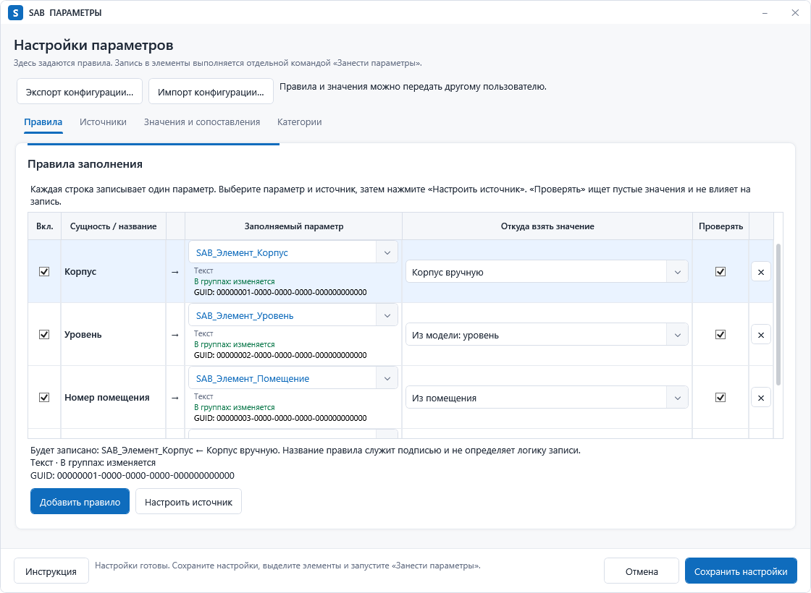
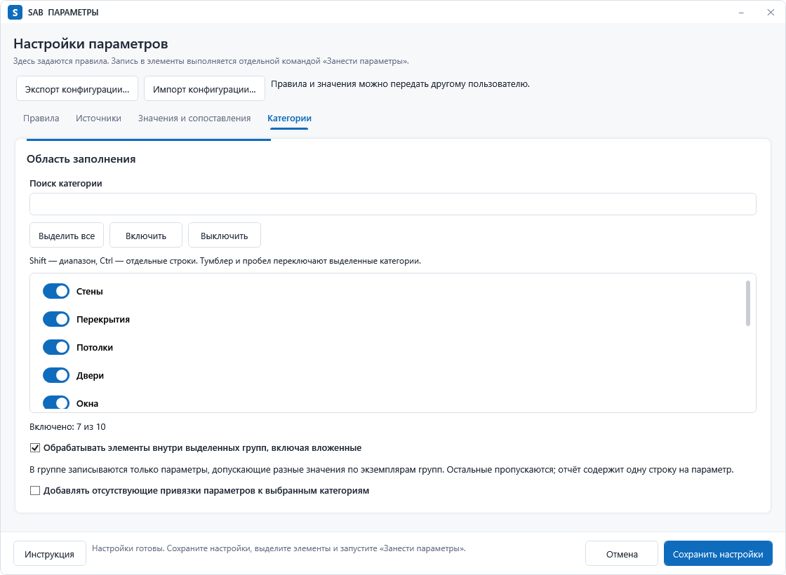
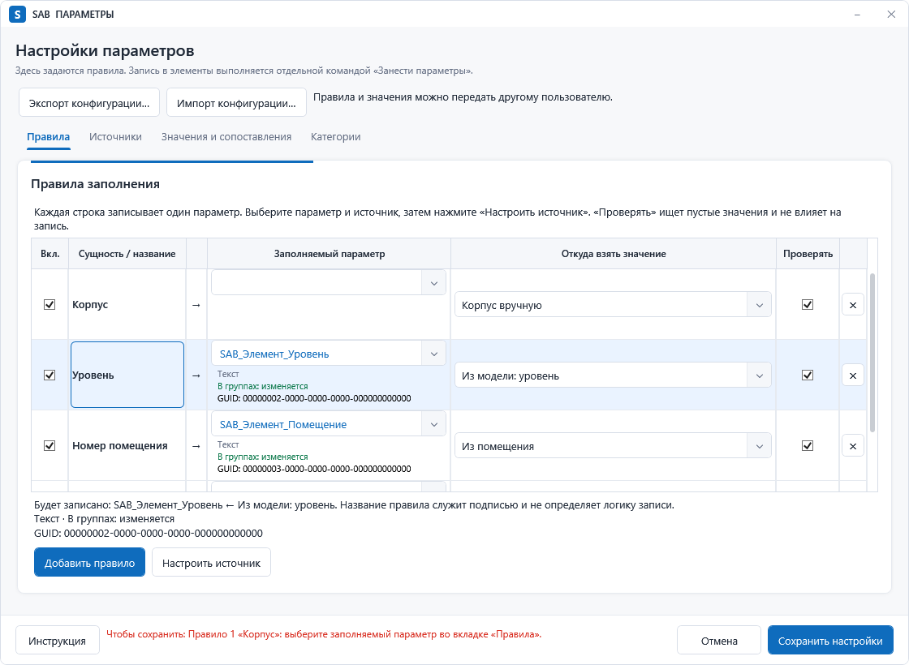

# SAB: выбор эталонного WPF-окна

Аудит от **11 октября 2026 года**. Репозиторий: `C:\Users\svetl\Desktop\Codex\Projects\SAB`, commit `565ebe7c2f3ced2611014b6e0363baa6ea5f1096`.

**Основной эталон — `SAB.ParameterTools.UI.SettingsWindow`, «Настройки параметров».** Это реальное окно SAB, целиком построенное из C#. Оно объединяет наиболее широкий набор пользовательских контролов и составных компонентов: 23 различных типа с учётом вложенных компонентов, контейнеров и моделей колонок. Если требуется эталон, обязательно имеющий XAML-файл, лучший вариант — `CreateViewsAndSheetsWindow`.

Рабочие окна, ресурсы, ViewModel, Binding, Command и бизнес-логика не изменены. Созданы только материалы этого аудита и отдельный хост для съёмки существующего окна. Новая дизайн-система и SAB UI Showcase на этом этапе не реализовывались.

## 1. Границы и результаты инвентаризации

Источники истины — исходники и явные `Compile`, `Page`, `Content` в `SAB/SAB.csproj`. Просканированы все исходные XAML репозитория и C#; отдельно разобраны конструкторы, фабрики `FrameworkElementFactory`, строки XAML, ресурсы, вложенные компоненты и динамические колонки. `bin`, `obj`, `packages`, `outputs`, резервные копии и дубликаты установленных сборок исключены. SAB-Plus и другие соседние репозитории не включены.

| Объект | Обнаружено | Как считать |
|---|---:|---|
| Исходные XAML во всём репозитории | 32 | 25 активных + 2 архивных + 5 тестовых/служебных |
| Активные XAML с корнем Window | 24 | каждый соответствует отдельному классу окна |
| Активные классы Window | **36** | 24 с XAML + **12 без XAML**; декоративные окна тоже учтены |
| Дополнительные `new Window` | 4 места | toast параметров, история, настройки уведомлений, служебный `_dummyWindow` |
| Пользовательские поверхности активной сборки | **39** | 36 именованных + 3 динамических; служебный владелец исключён |
| Собственный UserControl | **1** | `CategorySelectionControl`, C# |
| Другие собственные составные контролы | **2** | `ParameterPicker : StackPanel`, `AdaptiveSettingsGrid : Grid` |
| Page | **0** | MSBuild `Page Include` не означает WPF Page: здесь так компилируются словарь и Window |
| Отдельный активный ResourceDictionary-файл | **1** | `SAB/UI/Styles/SABWindowStyles.xaml` |
| ResourceDictionary-элементы активного XAML | 50 | 25 контейнеров ресурсов + 25 ссылок Source; это не 50 отдельных библиотек |
| ControlTemplate в активном XAML | **27** | 19 общих + 8 локальных |
| DataTemplate в активном XAML | **59** | в том числе 28 в редакторе графики и 13 в окне видов/листов |
| Style в активном XAML | **147** | 65 общих + 82 локальных |
| Фабрики шаблонов в C# | **7 DataTemplate + 5 ControlTemplate** | места определения/создания, не число экземпляров в рантайме |
| Именованные UI-типы в декларациях/конструкторах | **51** | включая Window, модели колонок, составные компоненты и внутренние части шаблонов |

36 классов означают наличие в активной сборке; доступность каждого из них из конкретного состояния ленты Revit отдельно не исполнялась. Вложенный декоративный `PoopDropWindow` учтён как класс, но не как кандидат для демонстрации форм.

Полный [каталог окон](window-catalogue.md) содержит назначение, модуль, XAML/C#, размеры, структуру, число и перечень типов, составные компоненты, сложность и нестандартные состояния **для каждого из 36 классов**. Дополнительные динамические окна описаны отдельно. Сырые данные: [inventory.json](inventory.json), [window-analysis.json](window-analysis.json), [types.csv](types.csv), [resources.csv](resources.csv), [dynamic-resources.csv](dynamic-resources.csv), [rankings.csv](rankings.csv). `windows.csv` содержит только XAML-окна; его числа не включают расширение через C# и вложенные компоненты. Реестр dynamic-resources фиксирует путь и строку каждой найденной фабрики C# и встроенного ControlTemplate.

Архивные `PlanCornerMarkAlignmentWindow` и `RoomGeometryToolsWindow`, прототип ModPlusInspiredElevation, Tools/UiReview и SyncReminderTest изучены отдельно и в рейтинг рабочего SAB не включены.

## 2. Что реально используется

В таблице перечислены все 51 обнаруженный тип. Колонки DataGrid, представление GridView, Run и фигуры отделены от самостоятельных контролов: они расширяют состав интерфейса, но не равнозначны новому виду пользовательского ввода.

| Группа | Фактически присутствует | Пример |
|---|---|---|
| Ввод, действия, текст, медиа — 12 | Button, TextBox, TextBlock, CheckBox, RadioButton, ComboBox, ToggleButton, Slider, ProgressBar, RichTextBox, Hyperlink, Image | Slider — GraphicOverrideEditorWindow/SyncReminderSettingsWindow; RichTextBox — развёртки; Image — напоминания |
| Контейнеры и навигация — 11 | Grid, StackPanel, WrapPanel, DockPanel, Border, GroupBox, Expander, TabControl, TabItem, ScrollViewer, Canvas | AdaptiveSettingsGrid расширяет Grid; Canvas используется в анимированных напоминаниях |
| Данные/содержимое — 6 | DataGrid, ListBox, ListView, ItemsControl, ContentControl, GridView | ListView + GridView — каталог оформления развёрток; ListBox — категории и шаблоны |
| Колонки — 4 | DataGridTextColumn, DataGridCheckBoxColumn, DataGridTemplateColumn, GridViewColumn | DataGridCheckBoxColumn — параметры и выбор дверей/окон |
| Собственные компоненты — 3 | ParameterPicker, CategorySelectionControl, AdaptiveSettingsGrid | собственные классы SAB |
| Вспомогательные части — 15 | Window, Run, ToolTip, Popup, ComboBoxItem, ContentPresenter, ItemsPresenter, ScrollContentPresenter, ScrollBar, Track, Thumb, RepeatButton, Path, Ellipse, SymbolIcon | Popup/Track/Thumb — общие шаблоны; SymbolIcon — WPF-UI |

**Не обнаружены в активном исходном WPF:** Label, GridSplitter, TreeView, DataGridComboBoxColumn, ContextMenu, Menu, MenuItem, Separator, StatusBar. Подписи реализованы через TextBlock. ComboBox в таблицах размещаются внутри DataGridTemplateColumn. Иерархия категорий графики построена на DataGrid с отступами и кнопкой раскрытия; имя `TreeToggleButtonStyle` не превращает её в TreeView. Такие отсутствующие типы не следует объявлять обязательными для первой версии Showcase.

ToolTip широко используется также через одноимённое свойство, без отдельного XML-тега. Popup реально входит в шаблон ComboBox; это раскрывающийся список, а не отдельный пользовательский сценарий всплывающего редактора. ListBoxItem, DataGridRow, DataGridCell и заголовки создаются WPF как контейнеры; стили их состояний также рассмотрены, но автоматически созданные контейнеры не добавлены к 51 типу деклараций/конструкторов.

**Составные компоненты SAB:**

- `ParameterPicker` — редактируемый ComboBox с собственной фильтрацией, клавиатурным подтверждением/отменой и карточкой типа, GUID/ID и поведения параметра в группах. Два варианта DataTemplate: со строкой имени и без неё.
- `CategorySelectionControl` — поиск, ListBox с множественным выбором, тумблер строки, массовое включение/выключение, счётчик. Встроен в настройки параметров и отдельное окно категорий проверки.
- `AdaptiveSettingsGrid` — перестраиваемая компоновка групп настроек развёрток/оформления.
- Собственные кнопки — преимущественно **стили стандартного Button**, а не наследники Button: Primary, Outline, Neutral, DangerOutline, RowIcon, Chrome/Close, графические ячейки и кнопки режимов.
- Комбинированный ввод — Slider + TextBox интервала синхронизации; выбор значения/параметра с метаданными; шаблонные поля и кнопки в таблицах; RichTextBox с фрагментами имени развёртки.
- Пользовательские таблицы — стандартный DataGrid с собственными колонками, группировкой, обработчиками выделения, пакетного редактирования и перетаскивания. Отдельного класса «SAB DataGrid» не найдено.
- Уведомления — SabStyledToastHost с Info/Success/Warning/Error, деталями, действиями и таймером; отдельный toast параметров; история и настройки уведомлений.
- Индикаторы — ProgressBar, подписи этапов/счётчиков, отметка «Изменено», состояния валидации и данные о параметрах.

**Библиотеки и стили, по локальным исходникам и packages.config:**

| Зависимость | Версия в проекте | Реальное применение |
|---|---|---|
| WPF-UI / Wpf.Ui.Abstractions | 4.3.0 | общий словарь подключает Fonts.xaml; SymbolIcon в шаблонах. Рабочие поля/кнопки в основном стандартные WPF с SAB-стилями |
| MaterialDesignThemes / MaterialDesignColors | 5.3.1 | ссылки в проекте сохранены; использования MaterialDesign-контролов или подключённых MD-словарей в активных XAML не найдено |
| Microsoft.Xaml.Behaviors.Wpf | 1.1.77 | ссылка сохранена; применения behaviors в активных интерфейсах не найдено |
| Notifications.Wpf | 0.1.1 | ссылка и using в FileOpenSave; живых экземпляров NotificationManager/NotificationContent не найдено; собственный WPF toast учитывать отдельно |
| Microsoft.Toolkit.Uwp.Notifications | 7.1.3 | ToastContentBuilder в ToastNotifier; Windows toast, не WPF-контрол внутри рабочего окна |
| Nice3point.Revit.Toolkit | 2022.4.0 / 2023.4.0 / 2024.3.0 | инфраструктура Revit; не библиотека визуальных элементов |

Все версии — зафиксированные зависимости этого checkout, не рекомендация обновить библиотеки. Общий визуальный ресурс — SABWindowStyles.xaml; локальные стили и C#-шаблоны остаются существенной частью оформления.

## 3. Рейтинг пяти кандидатов

Шкала каждого критерия: 0–10. Итог /100 = `3.5×И + 2×К + 1.5×Д + 1.5×С + 1×В + 0.5×А`.

И — разнообразие интерактивных сценариев (35%); К — компоновка/контейнеры (20%); Д — таблицы, списки, составные редакторы (15%); С — состояния (15%); В — пригодность для демонстрации (10%); А — автономность от Revit (5%).

Это экспертная сравнительная шкала, а не измеренный UX-бенчмарк. И оценивает разные действия и составные редакторы, а не повторения кнопок. К учитывает разные структуры и вложенность. Д: 0 — нет списков; около 4 — простая повторяемая область; 8–10 — редактируемые таблицы, несколько представлений, группировка/иерархия. С учитывает реальные переключения, валидацию, занятость, readonly и пустые результаты. В учитывает читаемость сценария и подготовку устойчивых тестовых данных. А: 10 — нет зависимостей Revit; 7 — достаточно библиотек и DTO без процесса/Document; 3–4 — рабочий конструктор зависит от Document/сервисов, нужен отдельный адаптер. Сборочные артефакты и число строк XAML баллов не дают.

| Место | Окно | И 35% | К 20% | Д 15% | С 15% | В 10% | А 5% | Итог |
|---:|---|---:|---:|---:|---:|---:|---:|---:|
| **1** | **ParameterTools.SettingsWindow** | 9.5 | 9.5 | 10 | 8.5 | 9 | 7 | **92.5** |
| 2 | CreateViewsAndSheetsWindow | 9 | 8.5 | 10 | 9 | 9 | 7 | **89.5** |
| 3 | ViewTemplateGraphicsWindow | 8 | 8 | 10 | 9 | 8 | 3 | **82.0** |
| 4 | ElevationSettingsWindow | 8 | 9.5 | 4 | 9 | 9 | 4 | **77.5** |
| 5 | MaterialRulesWindow | 6.5 | 6.5 | 8.5 | 9 | 9 | 6 | **74.0** |

| Окно и исходник | Почему вошло / ограничение |
|---|---|
| [Настройки параметров](../../../SAB/Cls_ParameterTools/UI/SettingsWindow.cs) | Единственный кандидат, объединяющий редактируемые таблицы, 4 вкладки, поиск параметров с метаданными, список категорий с тумблерами и разные формы источников. C#-композиция сложнее для смены темы; штатного Loading нет |
| [Создание видов и листов](../../../SAB/Cls_CreateViewsAndSheets/Views/CreateViewsAndSheetsWindow.xaml) | Лучший XAML-кандидат: форма + большая таблица, группировка, динамические колонки браузера, пакетное редактирование/перетаскивание, несколько режимов. Нет собственных ParameterPicker/CategorySelectionControl и TabControl |
| [Графика шаблонов](../../../SAB/Cls_ViewTemplateGraphics/Views/ViewTemplateGraphicsWindow.xaml) | 8 вкладок, список шаблонов, иерархическая таблица категорий, разные редакторы ячеек, трёхсостояние флажков. Рабочая ViewModel требует Document и data service, запускает обновление данных |
| [Развёртки](../../../SAB/Cls_InteriorElevations/Views/ElevationSettingsWindow.xaml) | Сильный пример адаптивной формы, вкладок, групп, зависимости полей и текстового предпросмотра RichTextBox. В самом окне нет DataGrid/ListBox/ListView; соседнее MultiRoomSelectionWindow не приписано ему |
| [Правила материалов](../../../SAB/Cls_MaterialQuantity/MaterialRulesWindow.xaml) | Поиск/фильтры, таблица с ComboBox, массовая операция, изменённые строки, прогресс. Меньше типов ввода/контейнеров; строки рабочей модели создаются из Revit Material, preview требует тестового адаптера |

Ближайшие следующие кандидаты: DoorWindowViewsWindow — 70.0; ElevationDecorationWindow — 66.5; CreateViewsAndSheetsSettingsWindow — 65.25. Оценки остальных именованных окон находятся в [rankings.csv](rankings.csv) и каталоге. Служебные и динамические уведомления оценены по составу в каталоге и уступают основным формам из-за узкого сценария.

## 4. Выбранный эталон

**Класс:** `SAB.ParameterTools.UI.SettingsWindow`. **Модуль:** Cls_ParameterTools. **Исходник:** `SAB/Cls_ParameterTools/UI/SettingsWindow.cs`. **XAML отсутствует.** Начальный размер 1120 × 820 DIP, минимум 980 × 680 DIP.

23 типа с учётом транзитивно вложенных компонентов: Button, TextBox, TextBlock, CheckBox, ComboBox, ToggleButton, TabControl, TabItem, DataGrid, DataGridTextColumn, DataGridCheckBoxColumn, DataGridTemplateColumn, ListBox, ContentControl, Grid, DockPanel, StackPanel, WrapPanel, Border, GroupBox, ScrollViewer, ParameterPicker, CategorySelectionControl. ToolTip и Popup доступны дополнительно через свойства/общие шаблоны.

Реальные разновидности компонентов: основная/нейтральная/иконная кнопка; обычное поле и редактор ячейки; ComboBox источника и редактируемый поисковый ParameterPicker; чекбокс в форме и колонке; тумблер строки категории; таблицы правил, корпусов, уровней, соответствий и значений для ручного выбора; выбор категории, пояснение параметра, статус проверки профиля; импорт/экспорт конфигурации. Таблицы/карточки источников создаются в зависимости от данных, поэтому одна пустая конфигурация не раскрывает возможности окна.

**Что отсутствует из реально используемого SAB:** RadioButton, Slider, ProgressBar, Expander, RichTextBox, ListView/GridView, Hyperlink, Image/Canvas, ItemsControl и AdaptiveSettingsGrid. Также нет группировки строк видов/листов, иерархии категорий графики, трёхсостояния флажков и полного набора toast-сообщений. Разные цвета поведения параметра в группе — метаданные, а не подтверждение успешного сохранения или ошибки валидации.

Для Fluent Light, Fluent Compact и Minimal SaaS окно удобно тем, что на одном наборе данных показывает плотную таблицу, лёгкую форму и список с переключателями. Сравнение должно сохранять одну структуру, один набор сценариев и одинаковый размер окна; иначе различия компоновки смешаются с различиями темы.

Есть ограничение: `Theme.Tabs`, `Theme.Toggle`, ParameterPicker и CategorySelectionControl содержат локальные шаблоны/цвета/размеры. Замена одного SABWindowStyles.xaml не перекрасит всё окно корректно. В дальнейшем эти отличия нужно адаптировать **только в тестовой версии Showcase**, сохранив реальный production-снимок как неизменный baseline. Нет оснований переносить новые темы в рабочий SAB в рамках этого аудита.

## 5. Проверенный запуск и снимки

Выполнена успешная сборка текущего `SAB.csproj` для Revit 2023 / .NET Framework 4.8 в отдельный каталог `outputs/ui-reference-audit/plugin`. Исходный класс окна загружен из свежей SAB.dll и создан через уже существующий конструктор с Profile и списками DTO. Отдельный [Preview.cs](Preview.cs) не заменяет UI искусственной копией.

**Процесс Revit и Document для такого запуска не нужны. Однако нужны установленные RevitAPI/RevitAPIUI и связанные библиотеки:** другой конструктор этого же класса содержит Document в сигнатуре, а сборка SAB и Storage ссылаются на API. Первый запуск выявил FileNotFoundException RevitAPI; разрешение сборок из установленного Revit 2023 позволило штатно создать окно. Поэтому «вне Revit» здесь не означает «на машине без библиотек Autodesk».

Рабочий конструктор с Document собирает данные из модели и для автономной демонстрации не используется. В preview используются вымышленные параметры, GUID, категории и уровни. Файловые импорт/экспорт, сохранение конфигурации и Revit-команды не вызывались.

Снимки — **RenderTargetBitmap реальных живых WPF-visuals после Show/Layout, 96 DPI**, а не снимки рабочего стола и не подтверждение работы плагина с моделью. Анимация появления отключена для стабильного кадра. Disabled изменён только в памяти preview; Error и Empty получены через существующие UpdateStatus и фильтр. Popup снят отдельно, поскольку это отдельная WPF-поверхность; монтаж не выполнялся.

| Файл | Содержание |
|---|---|
| [00-rules.png](screenshots/00-rules.png) | исходное оформление, таблица правил |
| [01-sources.png](screenshots/01-sources.png) | реальные панели источников, корпуса и режимы |
| [02-values.png](screenshots/02-values.png) | таблица сопоставления и область уровней |
| [03-categories.png](screenshots/03-categories.png) | поиск, список и тумблеры категорий |
| [04-editing.png](screenshots/04-editing.png) | выбранная строка и штатный BeginEdit текстовой ячейки |
| [05-parameter-dropdown.png](screenshots/05-parameter-dropdown.png) | настоящий раскрытый список ParameterPicker с метаданными |
| [06-disabled.png](screenshots/06-disabled.png) | отключённые выбор параметра и кнопка сохранения |
| [07-error.png](screenshots/07-error.png) | штатная ошибка при отсутствии целевого параметра |
| [08-empty-categories.png](screenshots/08-empty-categories.png) | реальный поиск без результатов |
| [09-minimum.png](screenshots/09-minimum.png) | исходное окно при минимуме 980 × 680 |

[Манифест съёмки](screenshots/capture-manifest.txt) фиксирует размеры, происхождение и проверенные переходы. Это smoke-проверка построения/отрисовки; Hover/Pressed вручную мышью не проверялись, клавиатурная доступность и большие наборы данных полностью не тестировались. Сборки Revit 2022/2024 и операции внутри Revit в этот аудит не входили.

Повторение: запустить inventory.py и catalogue.py bundled Python; затем [BuildPreview.ps1](BuildPreview.ps1), который собирает SAB.csproj с отдельными OutputPath/IntermediateOutputPath, компилирует хост и снимает окно. Хост preview и снимки независимы от установленного add-in. Скрипты не устанавливают и не публикуют сборку.

## 6. Предлагаемая структура SAB UI Showcase

**Отдельное тестовое WPF-приложение**, без `.addin`, Revit-транзакций и записи в рабочие профили. Это предложение следующего этапа, а не выполненный перенос.

| Область | Состав | Источник реальных компонентов |
|---|---|---|
| Эталон | Неизменённая версия существующего окна + фиксированные DTO; 4 оригинальные вкладки | SettingsWindow, Theme, ParameterPicker, CategorySelectionControl, SABWindowStyles |
| Тема | Baseline SAB / Fluent Light / Fluent Compact / Minimal SaaS; одинаковые данные и размеры | локальные словари тестового приложения; рабочие ресурсы не перезаписываются |
| Формы и настройки | RadioButton, Expander, Slider + TextBox, RichTextBox имени, адаптивная сетка, ссылка справки | GraphicOverrideEditorWindow, SyncReminderSettingsWindow, ElevationSettingsWindow, FrameModuleWindow |
| Таблицы и списки | Таблица правил; группировка видов/листов; иерархия категорий; readonly/редактируемые ячейки; ListView + GridView | CreateViewsAndSheetsWindow, ViewTemplateGraphicsWindow, ElevationDecorationCatalogWindow |
| Обратная связь | Info/Warning/Error/Success, toast с деталями, заполненный/пустой результат, прогресс | SabStyledToastHost, MaterialRulesWindow, MaterialQuantityProgressWindow |
| Состояния | Контролируемые наборы данных и отдельные демонстрационные экземпляры | WPF-состояния и локальные demo ViewModel/Command |

Сначала следует связать общие ресурсы с исходниками SAB, а не переписывать их приблизительно. Общие компоненты использовать из SAB, где это допускает доступность классов. Для internal/private UI-фабрик допустим текущий reflection-host эталона; для изменения концепции — отдельная тестовая копия/адаптер с указанием исходного файла и commit. Извлечение в production-библиотеку потребует отдельной задачи и не должно происходить побочно.

Частные шаблоны таблиц и UI-механику переносить в тестовую сборку с сохранением происхождения. Revit Document/Material заменять тестовыми DTO на границе demo; production ViewModel не менять. В новом Showcase команды должны выполнять только изменения демонстрационных данных. Обычные file/save/delete-кнопки рабочего окна не должны запускать реальные операции в приложении сравнения.

Первый демонстрационный набор: 8 правил с разными источниками, 12 параметров с совпадающими именами и разными GUID, 10 категорий, 6 уровней, таблица соответствий, длинные русские значения, выключенное правило, недоступный редактор, ошибочное правило. Для оценки плотности — ещё один набор из 100+ строк и одинаковая позиция прокрутки во всех концепциях.

Image/Canvas напоминаний можно показать в дополнительной секции; декоративную анимацию и её отдельные окна не следует делать основой визуального стандарта форм.

## 7. Состояния по компонентам

| Компонент | Демонстрировать | Способ |
|---|---|---|
| Button | Default, Hover, Pressed, Focused, Disabled | основной/нейтральный/иконный варианты; реальные ввод/нажатие и клавиатурный фокус, без запуска Revit-команды |
| TextBox / редактор ячейки | Default, Focused, Error, Disabled, ReadOnly | нормальный ввод, WPF ValidationError через demo validation rule; сообщение рядом с полем |
| ComboBox / ParameterPicker | закрыт/открыт, Focused, Selected, Disabled, пустой поиск, неверный/невыбранный параметр | существующая фильтрация и тестовые параметры; UI ошибки не подменять красными метаданными о группах |
| CheckBox / ToggleButton / RadioButton | unchecked/checked, Hover, Focused, Disabled; indeterminate только где поддержан | для трёхсостояния взять пример IncludeState графики шаблонов |
| TabControl / Expander | выбранная вкладка, Hover/Focused, раскрыто/свёрнуто, недоступный заголовок | самостоятельные демонстрационные экземпляры |
| DataGrid | заполненная/пустая таблица, Selected, current cell/Focused, редактирование, readonly, ошибочная ячейка | реальные разные модели колонок и отдельные наборы данных; 0 строк без выдуманных значений |
| ListBox / ListView | выбранная/множественно выбранные строки, Focused, пустой результат | категории и каталог; «нет совпадений» отличать от «нет данных» |
| Slider | Default, Hover/drag, Focused, Disabled, min/max | связь с TextBox интервала и прозрачностью |
| ProgressBar | определённый прогресс, indeterminate Loading, завершение/ошибка рядом | тестовые этапы; Success/Error относятся к операции, не к механическому состоянию каждой полосы |
| Сообщение / toast / панель статуса | Info, Warning, Error, Success, детали, Empty State, Loading | реальные шаблоны уведомлений; смысл передавать текстом и пиктограммой вместе с цветом |

Для Hover/Pressed использовать реальное состояние WPF или отдельный явно подписанный стенд эквивалентных визуальных состояний. Нельзя выдавать изменённый Background за проверку `IsMouseOver`/`IsPressed`.

У выбранного рабочего окна валидация профиля сейчас выводится в нижнем статусе. Наличие общих триггеров Validation.HasError у TextBox/ComboBox ещё не доказывает, что каждое его поле связано с ошибкой. Полноценную демонстрацию field-level Error создавать в тестовом адаптере. Hover/Disabled есть в общих стилях; обратную связь Pressed проверять вместе с SabWindowAnimationService: в базовом шаблоне Button нет отдельного универсального IsPressed-триггера.

## 8. Рекомендации для следующего этапа

1. Зафиксировать это окно как базу сценария и хранить текущие снимки отдельно от будущих концепций. Прежние Tools/UiReview и SAB-UI-Lab — тестовые макеты; не считать их снимками текущего production.
2. Сравнивать три концепции на одной компоновке и одинаковых данных. Fluent Compact должен показать выигрыш плотности на таблицах; Fluent Light — читаемость и состояния; Minimal SaaS — иерархию и минимум визуального шума с сохранением WPF-управления.
3. Составить карту семантических ресурсов и локальных исключений. Уже обнаружено расхождение: SabBrush.Warning в рабочем словаре `#FACC15`, в SAB_UI_STYLE.md — `#B54708`. Сначала выбрать роли цвета предупреждения/его фона в demo; не заменять ресурс вслепую.
4. Помимо цвета выделить типографику, размеры полей/строк, отступы, рамки, радиусы, фокус и состояния. Theme/ParameterPicker/CategorySelectionControl имеют локальные значения, которые нужно учитывать в сравнении.
5. Проверять 1120 × 820 и 980 × 680 DIP, 100/125/150% DPI, длинные названия и GUID, открытый Popup у границы экрана, прокрутку вложенных таблиц, клавиатуру и видимый фокус. В этом аудите снимки сделаны только в 96 DPI.
6. У ошибок/предупреждений/успеха сохранять текстовый смысл. Отдельно проверить контраст предупреждений, доступность отключённых полей и строку ошибки; не сообщать результат операции только цветом.
7. Для любой будущей интеграции соблюдать отдельное согласование конкретного окна. После выбора концепции сначала проверить Showcase, затем отдельной задачей переносить утверждённый вариант в SAB с сохранением логики и проверкой Revit 2022–2024.

**Технический итог:** выбор подтверждён статическим аудитом всех исходных интерфейсов и успешным запуском выбранного production-класса вне процесса Revit. Подтверждения бизнес-операций с моделью и новой дизайн-системы этот отчёт не заявляет.
